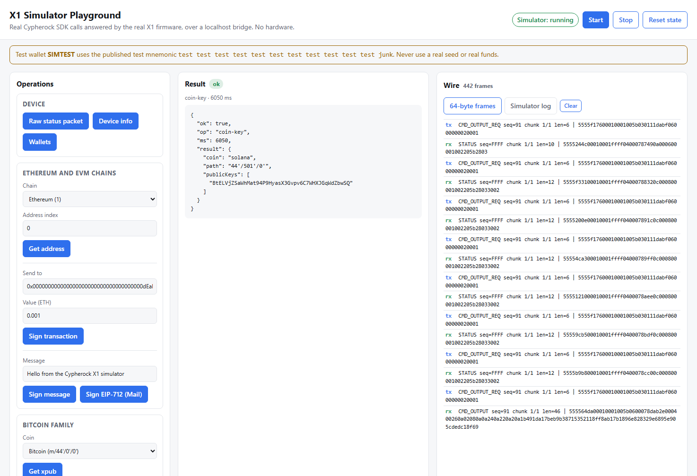
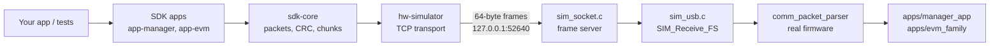

# Cypherock Simulator Bridge

Run the Cypherock SDK against the real X1 firmware simulator, with no hardware.

```ts
import { DeviceConnection } from '@cypherock/sdk-hw-simulator';
import { ManagerApp } from '@cypherock/sdk-app-manager';

const connection = await DeviceConnection.create();   // TCP 127.0.0.1:52640, not USB
const manager = await ManagerApp.create(connection);  // unchanged SDK code
console.log(await manager.getDeviceInfo());           // answered by real firmware code
```

**Status (Nov 15, 2026): working end to end.** The unmodified Cypherock SDK talks to the X1 firmware simulator built from `x1_wallet_firmware`. Device info, wallet list, EVM public key and transaction signing all come from the firmware's own code. Output from a fresh simulator:

```text
$ npx tsx examples/get-device-info.ts
SDK version reported by firmware: 3.0.0
{ "deviceSerial": "8485011716705c7dbe8fdf69291fa3fc11f6bc30b55262e38196d23562707ed5",
  "isAuthenticated": true, "isInitial": false, "onboardingStep": 5,
  "firmwareVariantInfo": { "variantId": 0, "variantStr": "MULTI_COIN" } }

$ npx tsx examples/get-eth-address.ts
address: 0xf39Fd6e51aad88F6F4ce6aB8827279cffFb92266
ethers:  0xf39Fd6e51aad88F6F4ce6aB8827279cffFb92266  MATCH

$ npx tsx examples/sign-tx.ts
viem recover:  0xf39Fd6e51aad88F6F4ce6aB8827279cffFb92266
ethers recover:0xf39Fd6e51aad88F6F4ce6aB8827279cffFb92266
OK: firmware signature verified by viem and ethers
```

Full outputs and the frame-by-frame trace are in [docs/notes/](docs/notes).

## Try it in the browser



```bash
# Any OS with Docker (builds upstream firmware + SDK with the patches, ~15 min)
docker build -t x1-sim-playground -f docker/Dockerfile .
docker run --rm -p 127.0.0.1:3000:3000 x1-sim-playground

# Or locally, after ./scripts/build-simulator.sh and the SDK build
npm run playground:web
```

Open http://127.0.0.1:3000. Start the simulator, then click: device info, wallets, an EVM address on 9 chains, sign a transaction / message / EIP-712, Bitcoin-family xpubs, and public keys for 10 more coins. Every 64-byte frame shows up decoded in the right panel. EVM results and the BTC xpub are marked **verified** when ethers derives the same thing from the test mnemonic. **Run every check** fills a pass/fail table.

## What works in the simulator

From the [capability matrix](docs/notes/capabilities.md) (`npm run capabilities`): **37 pass, 0 fail**, 1 needs a key press, 6 not run on purpose.

- **Manager:** getDeviceInfo, getWallets, getLogs, trainJoystick, trainCard. `selectWallet` waits for a joystick choice; authDevice/authCard need Cypherock's server; updateFirmware needs a bootloader.
- **EVM:** addresses on Ethereum, Polygon, BNB Chain, Fantom, Avalanche, Optimism, Arbitrum, Base, Hyperliquid; on-device address check; transaction signing (chains 1, 137, 8453); personal_sign; eth_sign; EIP-712. All verified with ethers.
- **Bitcoin family:** xpubs for BTC (legacy and segwit), LTC, DOGE, DASH; BTC address.
- **Other coins:** public keys for Solana, NEAR, Tron, XRP, Starknet, ICP, Stellar, Constellation, Sia, Canton.
- **Not working:** X1 card flows. The simulator's fake card speaks an old plaintext protocol while the firmware encrypts card commands, so this project uses a test-mnemonic wallet (`SIMTEST`) instead.

Every way to test (Docker, playground, examples, matrix, test layers, CI): [docs/testing.md](docs/testing.md).

## Why

Building on the Cypherock SDK today needs a physical X1 for every test. The firmware repo ships a desktop simulator, but its USB path was a stub (`SIM_Receive_FS()` was a `TODO` and its poll was never called), so nothing could reach it. This project adds the missing link:

- **SDK developers** try every SDK operation before buying hardware.
- **Cypherock engineers** run SDK and firmware tests together in CI.
- **Integrators** test failure cases (disconnects, busy device) that are hard to trigger on a real X1.

Nothing is mocked above the wire. sdk-core, the protobuf messages, the firmware's comm layer, its app handlers and its UI all run for real; only the USB cable is swapped for a localhost socket.

## How it works



The simulator polls the socket inside `BSP_DelayMs()`, every 5 ms, the way the USB interrupt fires while a real X1 waits. Details: [docs/architecture.md](docs/architecture.md), wire format: [docs/protocol.md](docs/protocol.md).

## Build status by phase

| Phase | What | State | Evidence |
| --- | --- | --- | --- |
| 0 | Bridge repo: TS transport, C bridge | Done | 17 transport tests; 2 TS <-> C tests; C unit tests run on Linux/macOS |
| 1 | Build the simulator | Done | `bin/Cypherock_Simulator` built from 555 files (Linux GCC, or Windows MSYS2 GCC 16) |
| 2 | Socket inside the simulator, loopback | Done | `CYPHEROCK_SIM_LOOPBACK=1` + `examples/connect.ts` echoes `68656c6c6f207831` |
| 3 | Real USB path through the bridge | Done | `examples/raw-status.ts`: firmware answers `STATUS_REQ` |
| 4 | `@cypherock/sdk-hw-simulator` in the SDK fork | Done | 14 Jest tests incl. real sdk-core handshake; ESLint and Prettier clean |
| 5 | M1 `getDeviceInfo`, M2 `getWallets` | Done | [m1](docs/notes/m1-get-device-info.txt), [m2](docs/notes/m2-get-wallets.txt) |
| 6 | EVM address and signing (M3 shortcut, M4) | Done with test wallet | [address](docs/notes/m2-get-eth-address.txt), [signature](docs/notes/m4-sign-tx.txt); real card emulation is a follow-up |
| 7 | Layer-4 tests and CI | Done locally; CI ready | 8 SDK <-> firmware tests pass; firmware unit tests 130/130; [ci.yml](.github/workflows/ci.yml) |
| 8 | Playground and demo video | Web playground done; video not made | `npm run playground:web` or Docker; [smoke test](tools/playground-smoke.ts) 33/33, [browser test](tools/playground-ui-test.ts) |

## Repository layout

```
cypherock-simulator-bridge/
├── packages/
│   ├── hw-simulator/              SDK transport (standalone copy of the SDK fork package)
│   └── mock-device/               byte-level fake device for transport tests
├── firmware-patch/
│   ├── x1_wallet_firmware.patch   every firmware change, applies to upstream 5b11739d
│   ├── simulator/transport/       sim_socket.c (POSIX + Winsock), sim_transport.c
│   ├── simulator/USB/sim_usb.c    simulator USB device over the bridge
│   ├── simulator/testing/         optional SIMTEST wallet (test mnemonic only)
│   └── test/                      C unit tests + loopback echo server
├── sdk-patch/sdk.patch            packages/hw-simulator + ConnectionTypeMap.SIMULATOR, applies to upstream 4e44158
├── examples/                      raw-status, device info, wallets, ETH address, sign-tx, terminal playground
├── playground/                    web playground: server.ts + public/ (no build step)
├── tools/                         capability matrix, playground smoke and browser tests
├── docker/Dockerfile              one-command playground image
├── integration-tests/             TS <-> C bridge, SDK <-> firmware simulator
├── scripts/                       build, start (waits until firmware is idle), stop, run tests
└── docs/                          architecture, setup (Linux + Windows), protocol, limitations, notes
```

## Quick start

Three sibling folders: this repo, `x1_wallet_firmware`, `sdk`. On Linux use Ubuntu 22.04; on Windows use the MSYS2 UCRT64 shell (see [docs/setup.md](docs/setup.md)).

```bash
# firmware: apply the patch to upstream (or use the fork branch feat/simulator-communication)
cd x1_wallet_firmware && git apply ../cypherock-simulator-bridge/firmware-patch/x1_wallet_firmware.patch
# sdk: add the transport package (or use the fork branch feat/simulator-transport)
cd ../sdk && git apply ../cypherock-simulator-bridge/sdk-patch/sdk.patch
pnpm install && pnpm exec turbo run build --filter="@cypherock/sdk-app-manager..." \
  --filter="@cypherock/sdk-app-evm..." --filter="@cypherock/sdk-hw-simulator..."

cd ../cypherock-simulator-bridge && npm install
./scripts/build-simulator.sh
export CYPHEROCK_SIM_TEST_MNEMONIC="test test test test test test test test test test test junk"
./scripts/start-simulator.sh              # opens the simulator window, waits until idle
npx tsx examples/get-device-info.ts
npx tsx examples/get-wallets.ts
npx tsx examples/get-eth-address.ts
npx tsx examples/sign-tx.ts
./scripts/stop-simulator.sh

CYPHEROCK_SIM=1 ./scripts/run-tests.sh    # all test layers
```

## Scripts

| Command | What it does |
| --- | --- |
| `./scripts/build-simulator.sh` | Builds `x1_wallet_firmware/bin/Cypherock_Simulator` (`CMAKE_BUILD_PLATFORM=Simulator`, `FIRMWARE_TYPE=Main`, `DEV_SWITCH=ON`) |
| `./scripts/start-simulator.sh [--echo\|--mock]` | Starts the simulator in `.sim-state/`, then waits until the firmware reports `IDLE` |
| `./scripts/stop-simulator.sh` | Stops it |
| `./scripts/run-tests.sh` | Runs every test layer available on this machine (`CYPHEROCK_SIM=1` adds layer 4) |

| Env var | Effect |
| --- | --- |
| `CYPHEROCK_SIM_PORT` | TCP port on 127.0.0.1 (default 52640), both sides |
| `CYPHEROCK_SIM_VERBOSE=1` | Simulator logs every frame in hex |
| `CYPHEROCK_SIM_LOOPBACK=1` | Simulator echoes frames instead of calling firmware |
| `CYPHEROCK_SIM_TEST_MNEMONIC` | Loads the `SIMTEST` wallet for this published test mnemonic |
| `USE_SDK_TRANSPORT=1` | Examples use `sdk/packages/hw-simulator` instead of the bridge copy |

## Documentation

- [Testing: every way](docs/testing.md) · [Architecture](docs/architecture.md) · [Setup: Linux and Windows](docs/setup.md) · [Wire protocol](docs/protocol.md)
- [Limitations and safety](docs/limitations.md) · [Upstream PR plan](docs/upstream-prs.md) · [Troubleshooting](docs/troubleshooting.md)

## Safety

The simulator is a development tool. It listens on 127.0.0.1 only. Use published test mnemonics only, never a real seed: the simulator's flash is a plain file. The `SIMTEST` shortcut compiles only into simulator builds (`USE_SIMULATOR=1`).

## License

MIT for code in this repository. Changes applied to the Cypherock repositories follow their licences. This is an independent community project, not an official Cypherock product.
