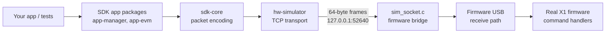

# Cypherock Simulator Bridge

Run the Cypherock SDK against the real X1 firmware simulator, with no hardware.

```ts
import { DeviceConnection } from '@cypherock/sdk-hw-simulator';
import { ManagerApp } from '@cypherock/sdk-app-manager';

const connection = await DeviceConnection.create();   // TCP, not USB
const manager = await ManagerApp.create(connection);  // unchanged SDK code
console.log(await manager.getDeviceInfo());           // answered by real firmware
```

## Why

Building on the Cypherock SDK today needs a physical X1 for every test. The firmware repo already ships a desktop simulator, but nothing connects the SDK to it. This project adds that missing link:

- **SDK developers** can try every SDK operation before buying hardware.
- **Cypherock engineers** can run SDK and firmware tests together in CI.
- **Integrators** (wallets, dApps, tools) can test failure cases (disconnects, rejections) that are hard to trigger on a real device.

Nothing is mocked above the wire. sdk-core, the protobuf messages and the firmware's command handlers all run for real; only USB is swapped for a localhost socket.

## How it works



Details: [docs/architecture.md](docs/architecture.md)

## Repository layout

```
cypherock-simulator-bridge/
├── packages/
│   ├── hw-simulator/          SDK transport (copy into your SDK fork)
│   └── mock-device/           Byte-level fake device for tests and CI
├── firmware-patch/
│   ├── simulator/transport/   C socket bridge (copy into your firmware fork)
│   ├── test/                  C unit tests + loopback echo server
│   └── Makefile               Builds the bridge without the firmware
├── examples/                  connect, device info, wallets, ETH address, playground
├── integration-tests/         TS <-> C bridge, SDK <-> firmware simulator
├── scripts/                   setup, build, start/stop simulator, run tests
├── docs/                      architecture, setup, integration guides, protocol, limits
└── .github/workflows/         CI for every layer that runs without hardware
```

## Quick start

Linux or macOS. On Windows use WSL2 Ubuntu.

```bash
# 1. Workspace with this repo and your two forks side by side
mkdir -p ~/projects/cypherock && cd ~/projects/cypherock
git clone https://github.com/YOUR_USERNAME/cypherock-simulator-bridge.git
cd cypherock-simulator-bridge
GITHUB_USER=YOUR_USERNAME ./scripts/setup.sh

# 2. Test everything that works without the firmware
./scripts/run-tests.sh

# 3. Try the transport against the C bridge
./scripts/start-simulator.sh --echo
npx tsx examples/connect.ts
./scripts/stop-simulator.sh
```

Then follow [docs/firmware-integration.md](docs/firmware-integration.md) and [docs/sdk-integration.md](docs/sdk-integration.md) to connect the real firmware and SDK.

## Status

| Layer | State | Test |
| --- | --- | --- |
| TS transport (framing, lifecycle, errors) | Done | `packages/hw-simulator/tests` (16 tests) |
| C socket bridge | Done | `firmware-patch/test` (3 tests) |
| TS transport <-> C bridge | Done | `integration-tests/c-bridge.test.ts` |
| Bridge wired into firmware simulator | To do in your fork | `CYPHEROCK_SIM=1` |
| `getDeviceInfo` end to end | Milestone 1 | `integration-tests/sdk-manager.test.ts` |
| Wallet list, ETH address | Milestone 2 | examples |
| Signing flows | Milestone 3 | see [docs/limitations.md](docs/limitations.md) |

## Scripts

| Command | What it does |
| --- | --- |
| `./scripts/setup.sh` | Checks tools, clones your forks, builds the C bridge |
| `./scripts/build-simulator.sh` | Builds the firmware simulator from your fork |
| `./scripts/start-simulator.sh [--echo\|--mock]` | Starts simulator, C echo bridge, or TS mock, waits for the port |
| `./scripts/stop-simulator.sh` | Stops it |
| `./scripts/run-tests.sh` | Runs every test layer available on this machine |

## Documentation

- [Architecture](docs/architecture.md)
- [Setup](docs/setup.md)
- [Firmware integration](docs/firmware-integration.md)
- [SDK integration](docs/sdk-integration.md)
- [Wire protocol](docs/protocol.md)
- [Limitations and safety](docs/limitations.md)
- [Upstream PR plan](docs/upstream-prs.md)
- [Troubleshooting](docs/troubleshooting.md)
- [Roadmap](docs/roadmap.md)

## Safety

The simulator is a development tool. It listens on 127.0.0.1 only. Never import a real seed phrase into it, and never use it for real funds. See [docs/limitations.md](docs/limitations.md).

## License

MIT for code in this repository. Files copied into the Cypherock forks follow those repositories' licences. This is an independent community project, not an official Cypherock product.
