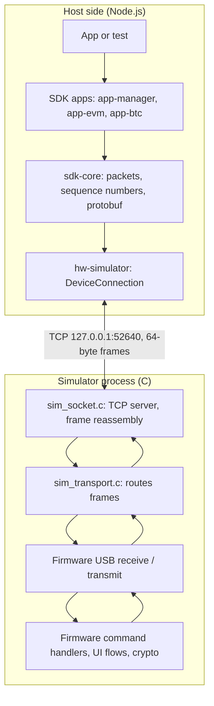

# Architecture

The bridge swaps one layer, the physical USB link, and leaves every other layer of the Cypherock stack untouched.

## Layers

| Layer | Owner | Changed by this project? |
| --- | --- | --- |
| SDK apps | Cypherock SDK | No |
| sdk-core | Cypherock SDK | No |
| Transport | **hw-simulator (new)** | Added beside hw-hid / hw-webusb |
| Wire | **TCP frames (new)** | Replaces USB HID reports |
| Socket bridge | **sim_socket.c (new)** | Added to simulator build |
| USB glue | **sim_transport.c (new)** + small firmware edit | Connects bridge to existing USB path |
| Firmware logic | Cypherock firmware | No |

## Design decisions

**Fixed 64-byte frames.** USB HID delivers whole reports; TCP delivers a byte stream. Fixed frames restore report boundaries with zero extra headers, so the firmware receives exactly what a USB report would give it.

**Non-blocking, single-threaded C.** The simulator has one main loop. `sim_socket_poll()` never blocks, so it can be called every iteration next to UI work without threads or locks.

**Localhost only.** The socket binds to 127.0.0.1. A simulator exposed on a network would be an unauthenticated signing endpoint.

**One client at a time.** Like one USB host. A new connection replaces the old one, which also makes test restarts simple.

**Generic socket, specific glue.** `sim_socket.c` knows nothing about Cypherock and is fully tested alone. `sim_transport.c` is the one file that touches firmware internals, so firmware changes upstream only ever break one small file.

**Three test layers before hardware or firmware.** Mock device (TS only), C bridge (C only), TS against C (both). Each failure points at one layer.

## Data flow for one SDK call

1. App calls `manager.getDeviceInfo()`.
2. sdk-core encodes the request into protocol packets and calls `connection.send()` per packet.
3. hw-simulator pads/splits into 64-byte frames and writes them to the socket.
4. sim_socket reassembles frames and calls `sim_transport`'s callback per frame.
5. sim_transport hands the frame to the firmware USB receive function.
6. Firmware parses, runs the handler, and writes the response through its USB transmit function, which now calls `sim_transport_write()`.
7. sim_socket frames and sends the bytes back.
8. sdk-core polls `connection.receive()`, reassembles packets, decodes the protobuf response, and resolves the promise.
