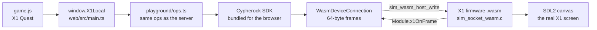

# Deploy: X1 Quest in the browser (GitHub Pages)

**Live:** https://xstranger-7.github.io/cypherock-simulator-bridge/

The hosted playground needs no server. Cypherock's X1 firmware is compiled to WebAssembly and runs inside the visitor's browser tab, next to the Cypherock SDK. Every visitor gets their own private simulator. GitHub Pages only serves static files, so hosting is free and never sleeps.



## What changes compared with the desktop simulator

| Part | Desktop (`npm run playground:web`) | Browser (GitHub Pages) |
| --- | --- | --- |
| Firmware | Native `bin/Cypherock_Simulator` (GCC) | `x1/Cypherock_Simulator.wasm` (Emscripten 7.0.0, clang) |
| Wire | TCP 127.0.0.1:52640 (`sim_socket.c`) | In-page queue, same 64-byte frames (`sim_socket_wasm.c`) |
| SDK transport | `@cypherock/sdk-hw-simulator` (`net` socket) | `web/src/wasmConnection.ts` (same `IDeviceConnection` contract) |
| Operations | `playground/server.ts` over HTTP + SSE | The same `playground/ops.ts`, through `window.X1Local` |
| Display | SDL window | SDL canvas in the page (click it; arrow keys, Enter and Esc work as the joystick) |
| Flash | Files in `.sim-state/` | Files in Emscripten's in-memory file system: a reload gives a fresh device |
| Threads | SDL refresh thread + LVGL tick thread | None: `BSP_DelayMs()` advances the tick, pumps SDL events and yields to the browser (Asyncify) |

Nothing above the wire changes. The same firmware sources, the same SDK packages, the same operations and the same checks run in both.

## Firmware changes for WebAssembly (firmware-patch)

All of these are simulator-only and switched by `__EMSCRIPTEN__`, so device and desktop builds are unchanged:

- `utilities/cmake/simulator/simulator.cmake`: when `EMSCRIPTEN`, use Emscripten's SDL2 port. Link with `-sASYNCIFY -sMODULARIZE -sEXPORT_ES6`. Export `sim_wasm_host_write` and `sim_wasm_host_connect`.
- `simulator/transport/sim_socket_wasm.c`: implements `sim_socket.h` with a byte queue. The page writes into it; frames from the firmware go to `Module.x1OnFrame`. `sim_socket.c` (TCP) is skipped in this build.
- `simulator/BSP/board.c`: in `BSP_DelayMs()`, the 5 ms wait becomes `emscripten_sleep()`. Before each sleep it advances the LVGL tick, handles SDL events and redraws the display. This is the work the two SDL threads did on the desktop.
- `common/startup/application_startup.c` and `simulator/lv_drivers/display/monitor.c`: no tick thread and no extra refresh sleep under Emscripten.
- `common/libraries/crypto/mpz_operations/mpz_ecdsa.c`: includes `memzero.h` and `rand.h`. Without them `memzero()` was declared implicitly as returning `int`, which the WebAssembly linker reported as a signature mismatch: a call that would trap at run time. This is a real missing include upstream; native builds only tolerate it.

## Build it yourself

```bash
# 1. Firmware to WebAssembly (Emscripten 7.0.0; python + protoc as for the desktop build)
git clone https://github.com/emscripten-core/emsdk.git && ./emsdk/emsdk install 7.0.0 && ./emsdk/emsdk activate 7.0.0
source ./emsdk/emsdk_env.sh
cd x1_wallet_firmware            # upstream 5b11739d + firmware-patch
emcmake cmake -S . -B build-wasm -G Ninja -DCMAKE_BUILD_PLATFORM=Simulator -DFIRMWARE_TYPE=Main \
  -DCMAKE_BUILD_TYPE=MinSizeRel -DDEV_SWITCH=ON -DUNIT_TESTS_SWITCH=OFF
cmake --build build-wasm         # -> bin/Cypherock_Simulator.js + .wasm (about 1.6 MB)

# 2. SDK packages built as for the desktop playground (sdk-patch applied)

# 3. Bundle and serve
cd ../cypherock-simulator-bridge
npm ci
npm run web:build                # -> dist-web/
npm run web:serve                # http://127.0.0.1:8090/
UI_SHOT_PREFIX=web- npx tsx tools/playground-ui-test.ts http://127.0.0.1:8090/   # plays all 11 levels
```

`web/build.mjs` reads `SDK_DIR` (default `../sdk`) and `FIRMWARE_WASM` (default `../x1_wallet_firmware/bin`).

The bundle loads in pieces. The page and the first level need about 400 KB of JS plus the 1.6 MB firmware; each coin's SDK app and its library (Tron, XRP, Stellar and so on) load only when a level needs them.

## How the GitHub Actions deploy works

`.github/workflows/pages.yml` runs on every push to `main`:

1. Builds the firmware: clones Cypherock's upstream at `5b11739d`, applies `firmware-patch/`, compiles to WebAssembly with Emscripten 7.0.0.
2. Builds the SDK: clones upstream at `4e44158`, applies `sdk-patch/`, builds the 13 SDK apps with pnpm and turbo.
3. Bundles the site with esbuild (`web/build.mjs`).
4. Starts the site on a local static server and plays all 11 levels in headless Chrome (`tools/playground-ui-test.ts`). A red check fails the job, and nothing is published.
5. Uploads `dist-web/` and publishes it with `actions/deploy-pages`.

One-time setup: repository Settings → Pages → Source: **GitHub Actions**.

## Limits of the browser build

- **The flash is in memory.** Reloading the page (or "Reset device") gives a freshly booted device with the SIMTEST test wallet.
- **Test mnemonic only.** Like every simulator build, it is a development tool. Never type a real seed into it.
- **One device per tab.** Each tab boots its own firmware. Nothing is shared between visitors, and nothing is sent anywhere.
- **Same features as the desktop simulator, same limits.** No X1 card flows, no device or card authentication (both need Cypherock's server), no firmware update.
